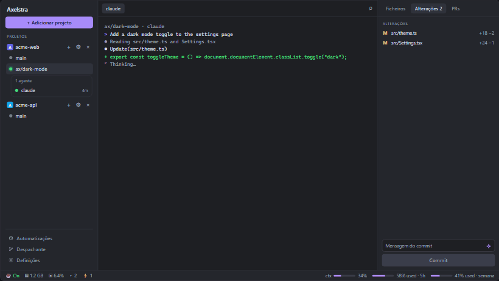

<p align="center"></p>

# Axelstra

<p align="center"><a href="https://github.com/DevFranciscoCruz/axelstra/actions/workflows/ci.yml"></a> <a href="LICENSE"></a></p>

Axelstra runs several AI coding agents in parallel, each in its own git worktree. It has three parts: a desktop app (Tauri + Rust, SolidJS frontend), a background daemon that owns the terminals and sessions, and the `axelstra` command line, which talks to the same daemon so agents can start and coordinate other agents themselves. Windows is the main platform; see [Platforms](#platforms) for what is verified elsewhere.

The interface comes in Portuguese (pt-PT), Brazilian Portuguese and English, picked in Settings. The CLI, the docs and the commit messages are in English.

<p align="center"></p>

<sub>Scripted mock with fake data: source in [`assets/demo/index.html`](assets/demo/index.html), open it in a browser to watch it live.</sub>

## Contents

- [Features](#features)
- [Agents](#agents)
- [Platforms](#platforms)
- [Install](#install)
- [Orchestration](#orchestration)
- [Security](#security)
- [Build from source](#build-from-source)
- [Tests and tools](#tests-and-tools)
- [Releasing](#releasing)
- [Known limitations](#known-limitations)
- [More documentation](#more-documentation)
- [License](#license)

## Features

**Worktrees and agents**

- **Projects and worktrees:** one sidebar entry per repo, one worktree per theme, each with its own terminals. A worktree can have a parent and its children nest under it; finished ones fold into a collapsed *Concluídos (N)* list.
- **Lead and workers:** the first agent of a worktree is its lead, named "main" and shown first. It is a dispatcher: it splits the request into subtasks and starts workers, shown as "Tarefa 1", "Tarefa 2", ... under it. When a worker finishes, a *Relatório* button opens the note it wrote (what it did, what passed, what is left).
- **Dispatcher:** `axelstra dispatch new` opens a worktree for a new topic with a lead; `axelstra dispatch send` routes a request to the worktree it belongs to. A lead started this way closes itself when it reports `done`.
- **Automatic cleanup (janitor):** a background sweep, every 10 minutes and shortly after each `done` or merge, removes `ax/*` worktrees whose work is integrated. It is safe by default: see [Worktree cleanup](#worktree-cleanup).
- **Sessions and safe restore:** terminals live in the daemon. After a reboot or an update they reopen where they were and Claude Code resumes its conversation (a `/clear` is followed). A task that reported `done` is marked in its spec and is never restored.
- **Waiting for an answer:** the red dot, the bell and the OS notification are driven by an event, never by reading the screen. The sources are `axelstra ask`/`escalate` and the agent's own hook (see [Agents](#agents)).
- **Awaiting something external:** `axelstra await --reason "CI #3703" [--for-min N]` marks the caller's own session as only waiting for CI, a deploy or another process. The app shows a state of its own (neither working, idle nor the red waiting) and the stall watchdog stays quiet. It ends when you type, new output arrives, the agent reports `done`, the process exits, `axelstra await --clear` runs or the limit passes (default and cap 2 h).
- **Finished sessions leave the list:** a session that ends on its own disappears from the list and from the saved state at once, with no leftovers to restore. A terminal that failed (non-zero exit) keeps its tab and shows the exit code until you close it. After a restart, sessions come back once, without duplicates or empty shells.
- **Stalled-agent watchdog:** an agent that goes quiet for a few minutes without reporting, asking or having running children gets an orange hourglass; its lead and the app are told once. `stall_minutes` in Settings sets the time, 0 turns it off.
- **Worktree env files:** list the untracked files a new worktree needs (`.env`, local config) in a `.worktreeinclude` at the repo root; they are copied in at creation.

**Code and shipping**

- **Files and editor:** file tree and editor; changes panel with diff and line comments that can be sent to a running agent.
- **Commit box:** an AI-suggested message from your `claude` CLI, following the repo's recent style. You edit it before committing; nothing is staged until you commit.
- **Pull requests, CI and issues** (need `gh`): once the branch has a pull request, the Changes panel shows CI (every check and its link), review decision and mergeability, refreshed every 20 seconds while visible. Auto-merge and squash-merge sit behind a confirmation.
- **Conflict assistant:** warns when worktrees edit the same files and rebases a worktree on `main` in one click.
- **CI triggers:** when a pull request's CI fails, an agent can be launched in its worktree to fix it.
- **Timeline:** per worktree, reports, tokens, CI and commits in order; exportable (ISO timestamps).
- **Kanban and orchestrator:** a markdown board of ideas, with cards you drag between columns; the orchestrator dispatches one agent per card and merges the results into an integration branch.
- **Automations:** scheduled agent runs in fresh worktrees (interval, daily, weekly).
- **Docker:** a *Docker* tab lists containers (compose groups with start, stop and restart), state, ports, CPU and memory, with info, logs, terminal and files per container, plus volumes, images and networks.

**Terminal and app**

- **Terminals:** split view, command palette (`Ctrl+K`), dev-server ports as chips that open in the browser. URLs and file paths in the output are clickable (Ctrl+click: code opens in the editor, `.html` in the browser; any other file, program or folder asks first in a confirmation dialog, with *Cancelar* focused, and can be shown in its folder, opened or, for programs inside the project, run). Paths that the terminal broke across lines are put back together.
- **Context menu:** right-click menus on sidebar rows, files, changes and Docker items.
- **Voice:** `Ctrl+Shift+M` dictates a prompt into the active terminal. Speech is recognized locally (Whisper, downloaded once, about 160 MB). Not on Linux, see [Known limitations](#known-limitations).
- **Search and usage:** `Ctrl+Shift+F` searches past Claude, Codex and Gemini conversations and resumes one. Tokens (input, output, cache) per worktree are read from the agent logs; no cost is estimated.
- **Budgets and limits:** daily and weekly token limits per worktree; you are notified when one is near or over, and a runaway agent can be paused. `axelstra limit N` caps concurrent workers.
- **Notifications:** a bell lists the last 100 events (agent finished or waiting, CI changed, merge done, errors), kept across restarts. On Windows, clicking the toast opens that session; elsewhere the worktree gets an attention dot instead.
- **Memory governor:** watches free memory; under pressure it warns, delays new agents and builds, and can freeze the biggest idle consumers until memory recovers (nothing stays frozen). `axelstra mem`, `axelstra resume`, [`docs/MEMORY.md`](docs/MEMORY.md).
- **Status bar:** keep-awake switch, memory, terminals, listening ports, total agent tokens, a list of running agents and a worktree overview. The bell, terminals, branches and ports each open a popover.
- **Remote hosts:** projects on a WSL distro or an SSH host run on that machine's own daemon, driven from the same app ([`docs/remote-daemon.md`](docs/remote-daemon.md) says what is not supported there).
- **Workspace transfer:** `axelstra workspace export|import` and the Settings buttons move projects, automations, settings and Kanban cards between machines (no tokens, no sessions; the import shows a preview first).
- **Backup and diagnostics:** Settings exports and restores the daemon's state (rotating copies are also kept) and copies a diagnostics report. A state file that cannot be read is set aside, never overwritten, and you are told.
- **Audit log:** the commands agents send to the daemon are recorded and shown in the app.
- **Languages:** pt-PT, English and pt-BR, switched live.
- **Version and build info:** Settings > About shows the app version, commit and build date next to the same fields of the running daemon, and a *Copy info* button puts them (plus OS and protocol) on the clipboard for a bug report. The version is also in the footer. If the daemon is older than the app (it outlives updates), About warns about the mismatch; an old daemon that does not report the fields shows "unknown". On the command line: `axelstra --version` / `-V` prints version, commit and date; `axelstra version --json` prints them as JSON.
- **Layout:** `Ctrl+B` hides the project list, `Ctrl+Shift+B` the right panel.

### Add project

*+ Adicionar projeto* is one dialog with six origins, a tab list on the left (arrows move and select, Home/End jump, Enter runs the
main button, Esc closes). It reopens on the origin you used last.

| Origin | What it does | Needs |
| --- | --- | --- |
| Local folder | Adds a folder that already exists, chosen in the system dialog | nothing |
| Clone | `git clone` of an `https://`, `ssh://` or `user@host:path` address into `folder/name`, optional branch and depth, with progress and Cancel (a clone keeps running if you close the dialog) | `git` and whatever credentials it already has (credential manager, ssh key) |
| GitHub | Lists your repositories (filter, arrows, Enter or click clones) | the GitHub CLI: install `gh` and run `gh auth login` once |
| New project | A new folder with `git init`, optionally a README, a `.gitignore` and the first commit | `git`; for the commit, `user.name` and `user.email` (without them the project is still created and the dialog says so) |
| Remote | A folder on a WSL distro or an SSH host, which runs its own daemon; detected distros and `~/.ssh/config` hosts are offered | WSL, or an ssh key (see [`docs/remote-daemon.md`](docs/remote-daemon.md)) |
| Discovered | Git repositories already on disk (`Projects`, `Projetos`, `Documents/GitHub`, `source/repos`, `dev`, `code`, `Desktop` under your home, two levels deep) that are not projects yet | nothing |

Axelstra never asks for, stores or passes a token: clone and GitHub use your own git and `gh` login. The daemon validates what the
page sends: clone accepts only `https://`, `ssh://` and `user@host:path` (no leading `-`, no `ext::`, no spaces; `file://` only under test),
the destination must be absolute and empty or missing, a new project name is one folder name, and a discovered repository must be one
the last scan returned.

### Remove project

Removing a project asks what to do. *Only from the list* just drops it from Axelstra. *Remove everything* also closes the project's sessions and terminals, removes its worktrees (only those under `.axelstra-wt`) with their `ax/*` branches, and deletes its records (task notes, dispatcher entries, triggers, automations, flows, janitor events). A preview first lists the sessions, terminals and worktrees, and warns about worktrees with uncommitted changes or unintegrated work; removing those anyway needs you to type the project name. The project's own checkout is never touched. A folder still held by a process Axelstra does not own stays whole and is retried later.

### Worktree cleanup

The janitor removes a worktree only when all of this holds:

1. It is marked `auto` (created by `axelstra dispatch new`) or its `ax/*` branch is really integrated with its own commits (in the default branch, in another live `ax/*` branch, or its pull request was merged). A branch with no commits of its own never counts as merged.
2. It has no uncommitted changes.
3. No session worked in it for 10 minutes (an `auto` worktree whose agent reported `done` is exempt).

Hand-made worktrees and those from `worktree.from_pr` only leave through real integration; an empty one never leaves by itself. A removal that cannot finish (folder held by another process) is retried with exponential backoff. `axelstra worktree sweep --dry-run` lists what would go; `axelstra worktree sweep --auto off` turns the background sweep off (it is on by default). Removals appear as a toast and in the notification center.

## Agents

| | Claude Code | Codex | Gemini CLI |
| --- | --- | --- | --- |
| Launch from the app, one click | yes | yes | yes (`gemini -i <prompt>`) |
| Unattended / orchestrated runs | `-p` | `exec` | `--skip-trust -p --approval-mode auto_edit`; `--skip-trust` only in `ax/*` worktrees not made from a pull request |
| Resume after a restart | yes (`--continue`, follows `/clear`) | yes (`resume --last`) | yes (`--resume latest`) |
| Status hooks (exact waiting dot) | yes, installed in `~/.claude/settings.json` | understood by `axelstra hook codex`, but nothing installs them; not verified end to end | yes, installed in `~/.gemini/settings.json` |
| `/axelstration` skill | `~/.claude/skills` | `~/.agents/skills` | `~/.agents/skills` |
| Search past conversations, tokens per worktree | yes | yes | yes |

Gemini was verified against gemini-cli 0.65.0, Claude Code hook types against 2.1.310; [`docs/AGENTS.md`](docs/AGENTS.md) lists what was exercised and how, and what was not (a real Gemini model, login flows, the UI with a Gemini session). The source of truth for launching and resuming is `crates/core/src/agents.rs`. Any other CLI on the `PATH` can be started as a plain terminal agent (`axelstra agent --agent <command>`), without resume, hooks or skill.

### Agent status hooks

An agent with hooks tells Axelstra when it needs you. Settings has one button per agent, or run `axelstra hook install claude` / `axelstra hook install gemini` (`hook status` checks them; a backup of the file is made). The hooks run `axelstra hook <agent> EVENT`, only act inside Axelstra sessions (they need `AXELSTRA_SESSION`), print nothing useful when the daemon is down and exit 0 at once. For Claude Code that is:

```json
{
  "hooks": {
    "Notification": [{ "hooks": [{ "type": "command", "command": "axelstra hook claude Notification" }] }],
    "Stop": [{ "hooks": [{ "type": "command", "command": "axelstra hook claude Stop" }] }],
    "UserPromptSubmit": [{ "hooks": [{ "type": "command", "command": "axelstra hook claude UserPromptSubmit" }] }]
  }
}
```

A permission prompt or question turns the dot red; `idle_prompt` is only idle. The dot clears on your input, on new output or when the turn ends, and a hint older than two hours is ignored. A session whose agent has no hooks (Codex today) is only working or idle: there is no screen-text guessing.

## Platforms

| Platform | State |
| --- | --- |
| Windows x64 | Main platform. Everything is developed and tested here, including the real-app E2E. CI runs the engine tests on Windows, macOS and Linux. |
| Linux | Experimental. CI lints and tests the engine (core, daemon, CLI) on Ubuntu and runs the CLI smoke there. The desktop host is only compile-checked. Nobody has run the app on a Linux desktop. |
| macOS | **No release builds yet**: there is no Apple Developer account, so the macOS release jobs are off (set the repository variable `RELEASE_MACOS=true` and the `APPLE_*` secrets to enable them, see `docs/RELEASING.md`). Once on, the release builds an Apple silicon `.dmg` (and an experimental Intel one). CI runs the engine tests and lints there. **The app's runtime is not verified**: no one has run the desktop app on macOS. |

## Install

Download the latest installer from the [Releases page](https://github.com/DevFranciscoCruz/axelstra/releases/latest):

| Platform | File |
| --- | --- |
| Windows (x64) | `Axelstra_<version>_x64-setup.exe` |
| macOS (Apple silicon) | not available until Apple signing exists (`Axelstra_<version>_aarch64.dmg` once enabled) |
| macOS (Intel, experimental) | not available; a `.dmg` only once macOS releases are enabled and that job succeeded |
| Linux (experimental) | `.deb` and AppImage |

Requirements: `git`, plus the agent CLI you use (`claude`, `codex` or `gemini`) on your `PATH`; `gh` for pull requests, `docker` for the Docker tab. The welcome screen shows which it found.

**Windows updates.** Axelstra checks GitHub Releases at launch, every 6 hours and when the window regains focus. A newer version is downloaded and verified in the background; a card offers *Reiniciar agora* or *Mais tarde*, and a downloaded update is also installed when you close the app. Terminals and agents are not interrupted: they belong to the daemon, which the installer moves aside instead of stopping. The daemon only picks up new code when it next starts (reboot, or when the app finds it too old, in which case its terminals are restored). The first install is manual.

**macOS.** Not released for now (see the table above); the rest of this paragraph applies once releases are enabled. The `.dmg` is the first install; after that the app updates itself. Releases are signed with a Developer ID and notarized (a real release fails without the Apple secrets). A build made without them is unsigned: open it with right-click, Open, or `xattr -dr com.apple.quarantine /Applications/Axelstra.app`. The first dictation asks for microphone access.

**Windows signature.** The installer is signed for the updater but not yet with an Authenticode certificate, so SmartScreen may warn on first run. See [Known limitations](#known-limitations).

**Linux.** The files are not signed for the updater, so install each release by hand. Keep-awake uses `systemd-inhibit` when present; notification clicks do not open the session.

## Orchestration

Inside any Axelstra terminal the `axelstra` command is on the `PATH` and talks to the same daemon as the app, so whatever it starts shows up as a tab. Agents learn it from the `/axelstration` skill, which the app installs (or run `axelstra install-skill`); the guide is served by the binary: `axelstra skills get axelstration`.

```sh
axelstra dispatch new <project> <name> "request"      # new topic: worktree + lead agent
axelstra dispatch send <worktree> "request"           # route a request to an existing topic
axelstra worktree create <project> <name>             # one worktree per task
axelstra agent <worktree> --prompt "..." --report-to $AXELSTRA_SESSION   # ephemeral worker
axelstra run <worktree> --report-to -- cargo test     # one-shot command, no agent needed
axelstra ask <session> "question"                     # blocks until the answer (axelstra reply)
axelstra done "summary"                               # report and finish
axelstra escalate "problem"                           # ask the parent for help
axelstra flow plan.json                               # task graph with dependencies
axelstra limit 4                                      # at most 4 workers at once
axelstra lock verify -- node scripts/check.mjs        # heavy command, one at a time across worktrees
```

Run `axelstra --help` for the rest. The command palette entry *Orquestração* shows coordinators and their workers, with state and unread messages. The lifecycle rules (lead, workers, janitor) are in [`AGENTS.md`](AGENTS.md).

## Security

- **Roles in the daemon.** The daemon decides who is calling from the process on the other end of the connection, not from the token it presents. Agents run with a per-session token (`AXELSTRA_AGENT_TOKEN`) and the `agent` role: they can use the orchestration commands but cannot register projects, change hosts, enable screen control, export or restore backups, or start arbitrary programs. Messages between sessions carry the authenticated sender.
- **`SECURITY_MIN`.** The app restarts a daemon older than the minimum it accepts for security reasons, whatever its protocol version.
- **Untrusted code.** A worktree made from a pull request gets no `.worktreeinclude` files and no trust flag for agents (`--skip-trust` only goes to `ax/*` worktrees that are not PR code). Kanban cards that ask for a `bypass*` permission mode or carry acceptance commands need an explicit confirmation of the exact content; `docker compose` files are checked before they run.
- **The app.** Strict CSP with no `unsafe-inline` for scripts or styles (so no static `style="..."` in the frontend), minimal Tauri capabilities, a method allow-list between the webview and the daemon, terminal links limited to `http(s)`; a path clicked in a terminal never runs anything by itself: a confirmation dialog (real click only, focus on Cancel) precedes `files.path_action`, which the daemon re-resolves, confines to the session's project, refuses to agents and audits when it runs a program. `scripts/check-tauri-config.mjs` guards this in CI.
- **Your data.** State lives in the per-user data dir with atomic writes, rotating copies and a schema version; the token file is private to the user.

[`SECURITY.md`](SECURITY.md) has the policy and how to report a vulnerability; [`docs/s3-app-secret.md`](docs/s3-app-secret.md) explains what is still open in the role model.

## Build from source

Needs Rust (the version pinned in `rust-toolchain.toml`), LLVM/libclang (for the speech engine; set `LIBCLANG_PATH` on Windows), Node 22 (`.nvmrc`) and, on Windows, the Tauri prerequisites (WebView2, MSVC build tools). On Linux install the Tauri 2 system packages first: `libwebkit2gtk-4.1-dev libgtk-3-dev libayatana-appindicator3-dev librsvg2-dev libxdo-dev libssl-dev patchelf`.

```sh
# Windows: daemon sidecar + frontend + NSIS installer; prints the installer path
powershell -File scripts/build-installer.ps1

# macOS
sh scripts/prepare-sidecar.sh && cd app && npx tauri build --bundles dmg --config src-tauri/tauri.release.conf.json

# Linux (experimental)
sh scripts/prepare-sidecar.sh && cd app && npx tauri build --config src-tauri/tauri.release.linux.conf.json
```

The commit and build date shown by About and `axelstra --version` come from `AXELSTRA_GIT_SHA` (7-char sha) and `AXELSTRA_BUILD_DATE` (UTC `YYYY-MM-DD`), read when the crates compile. `scripts/build-installer.ps1` sets both; elsewhere they fall back to `git rev-parse --short=7 HEAD` (else `unknown`) and today's date.

Local builds are not signed for the updater, so they never produce update artifacts. Heavy builds inside an Axelstra worktree go through `axelstra lock verify -- <cmd>`.

## Tests and tools

| What | Command |
| --- | --- |
| Whole local gate (fmt, clippy, Rust tests, `tsc`, vitest, i18n and config checks) | `node scripts/check.mjs` (`--engine` skips the desktop toolkit) |
| Engine tests | `cargo test --no-fail-fast -p axelstra-core -p axelstra-daemon -p axelstra` |
| Desktop host tests | `cargo test -p axelstra-app` |
| Frontend | `cd app && npm ci && npx tsc --noEmit && npm test` |
| CLI and daemon smoke | `node tools/smoke.mjs` |
| Real app E2E (Windows, over the DevTools protocol; includes the Add project dialog) | `node tools/e2e.mjs` |
| Screenshots of the real app, three languages | `node tools/visual.mjs` |

Tests never touch your real data dir or pipe: they use `AXELSTRA_DATA_DIR` (see [`docs/TESTING.md`](docs/TESTING.md)). The app-level drivers set `AXELSTRA_TEST_HIDDEN=1`, which creates the window transparent and unfocusable, so no window appears while they run. Details: [`docs/TOOLS.md`](docs/TOOLS.md), [`docs/E2E.md`](docs/E2E.md). Contributing notes: [`CONTRIBUTING.md`](CONTRIBUTING.md).

## Releasing

`git tag vX.Y.Z && git push origin vX.Y.Z` runs `.github/workflows/release.yml`, on a commit that is already on `main`. It runs the whole CI, stamps the tag into the three version fields (Cargo workspace, `app/package.json`, `tauri.conf.json`), builds the Windows installer and the macOS apps (daemon as sidecar, signed for the updater), uploads them to a draft release, merges `latest.json` and only then publishes. An experimental Linux job (`.deb`, AppImage) and an experimental Intel macOS job may fail without blocking the release. The release notes come from the commit subjects (git-cliff, `cliff.toml`).

Signing secrets are GitHub Environment secrets: the `release` Environment holds them (required reviewers, tags limited to `v*`) and `release-publish` is the last optional manual gate. Started manually with *dry run* on (`workflow_dispatch`), the workflow builds and signs but publishes nothing and keeps the installer on the run. The updater verifies each download against the public key in `app/src-tauri/tauri.conf.json`; losing the private key means existing installs can no longer update. Key custody, rotation and rollback: [`docs/RELEASING.md`](docs/RELEASING.md) and [`docs/DISTRIBUTION.md`](docs/DISTRIBUTION.md).

## Known limitations

- **macOS runtime is not verified.** CI runs the engine tests, compile checks and lints there, but nobody has run the desktop app. Known risks: no subreaper, so a fully detached agent process can be classified as a user process, and no parent-death signal for `axelstra lock`.
- **Codex has no hook installer.** `axelstra hook codex` understands its events, but nothing installs them (Codex asks to trust each hook), so Codex sessions are only working or idle.
- **Windows Authenticode is not configured.** The optional Azure Trusted Signing step in `release.yml` exists but has not run; SmartScreen warns about the installer until a certificate is set up.
- **Linux is experimental** and no one has run the desktop app there. Voice dictation is off on Linux: the upstream sherpa-onnx static archive for linux-x64 ships no libraries, so the engine cannot be linked; the microphone button is hidden and `Ctrl+Shift+M` shows a notice.
- **Installer warning when updating over a running app (Windows):** not verified end to end; the installer moves the daemon aside instead of stopping it, but the prompt shown when the app is still running has not been checked.
- **The release workflow has not been proven on GitHub**: run a dry run before relying on a tag (the Apple and updater secrets must exist in the `release` Environment).
- **Remote hosts:** Docker, screen control, automations and `open` are refused for remote projects, and ssh needs a key (no password or 2FA prompts). See [`docs/remote-daemon.md`](docs/remote-daemon.md).
- **Add project dialog:** a folder dropped on the *Pasta local* zone only shows which folder to pick in the system dialog, because the webview gets no path it may hand to `project.add` (the dialog is the only way a path enters). Opening an existing worktree or branch and `worktree.from_pr` are not in the dialog: add the project first, then use the sidebar. There is no token entry (private repositories need `gh auth login` or a git credential helper set up outside Axelstra). Git never prompts from the dialog (`GIT_TERMINAL_PROMPT=0`, ssh `BatchMode`), so a clone that needs a password you have not stored fails with git's message.
- **B3, open:** the "Incluir CI" option in the timeline once showed "Maximum call stack size exceeded" in an installed build; it does not reproduce on current code. If it comes back, report the devtools stack trace and the project.

## More documentation

[`AGENTS.md`](AGENTS.md) (layout, build, lifecycle rules) · [`docs/AGENTS.md`](docs/AGENTS.md) (agent support notes) · [`docs/MEMORY.md`](docs/MEMORY.md) · [`docs/TESTING.md`](docs/TESTING.md) · [`docs/TOOLS.md`](docs/TOOLS.md) · [`docs/E2E.md`](docs/E2E.md) · [`docs/RELEASING.md`](docs/RELEASING.md) · [`docs/DISTRIBUTION.md`](docs/DISTRIBUTION.md) · [`docs/remote-daemon.md`](docs/remote-daemon.md) · [`docs/s3-app-secret.md`](docs/s3-app-secret.md) · [`SECURITY.md`](SECURITY.md) · [`CHANGELOG.md`](CHANGELOG.md)

## License

[MIT](LICENSE), © 2026 Francisco Cruz.
